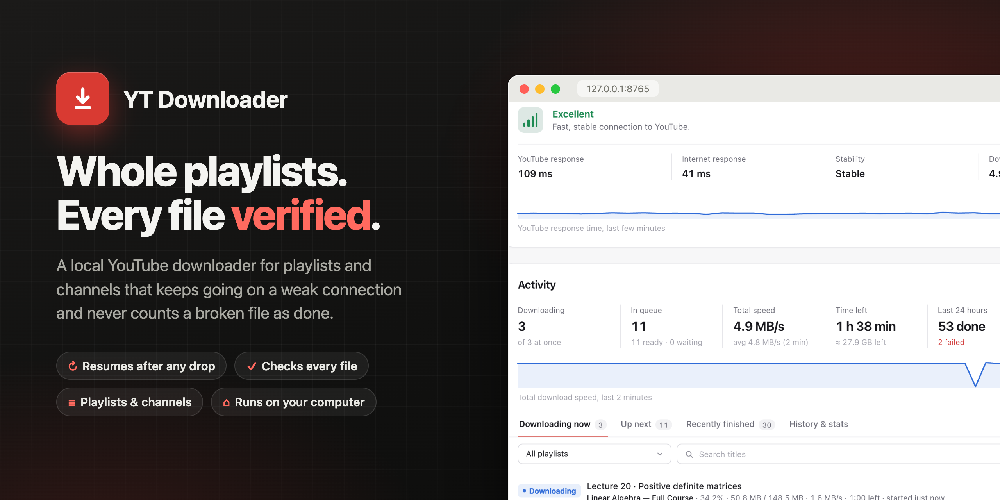
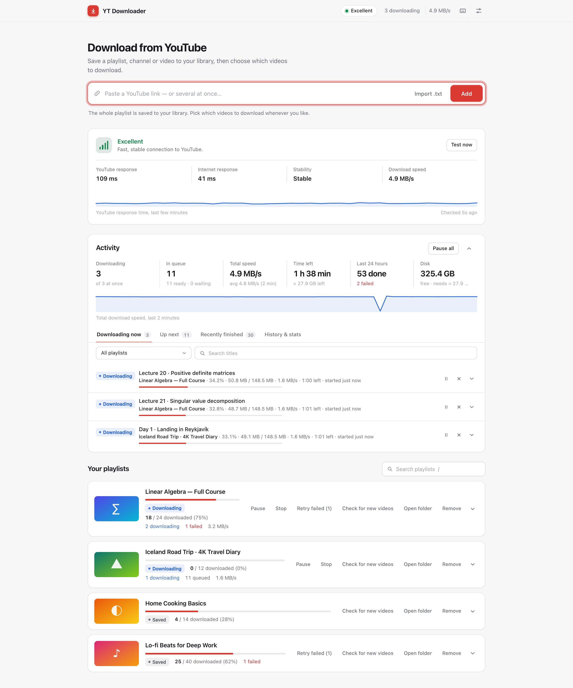
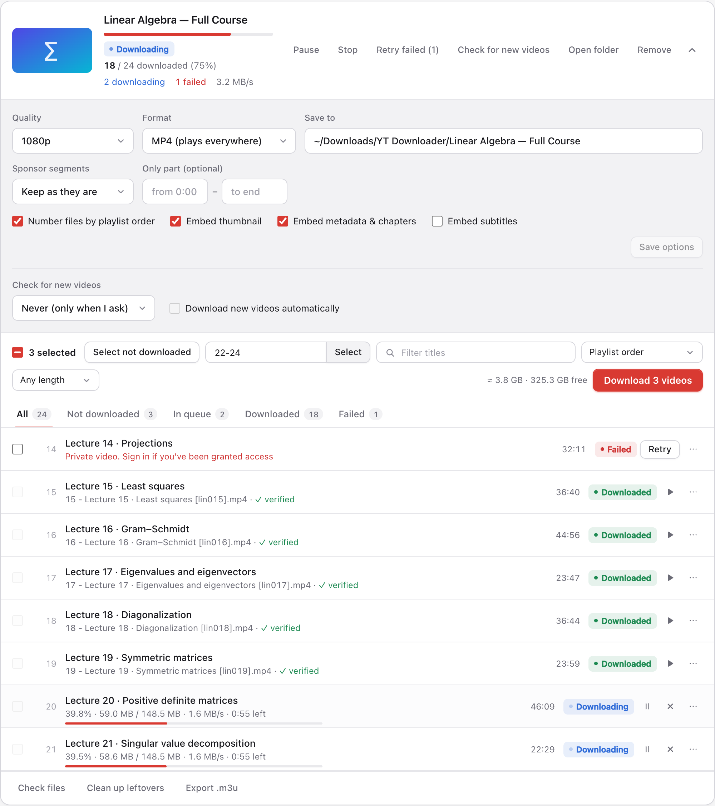
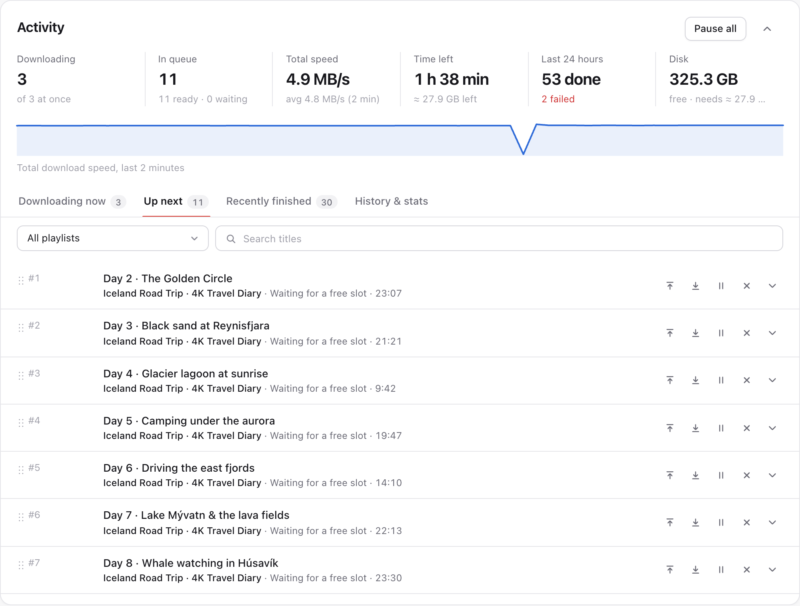
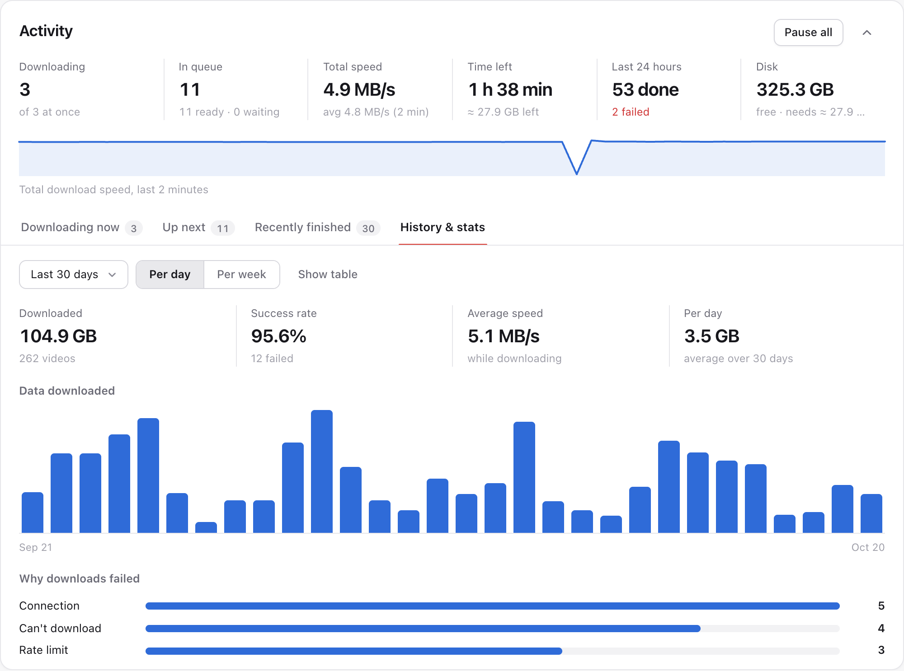
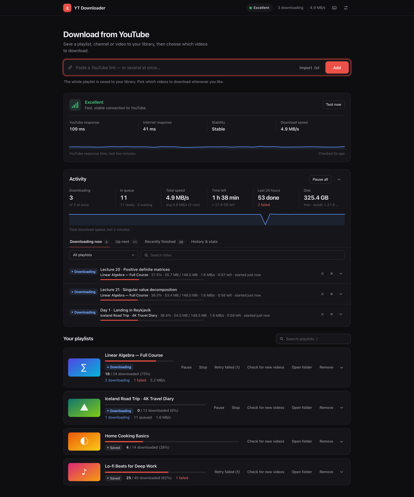

<p align="center">
  
</p>

<p align="center">
  <b>A local YouTube downloader for whole playlists and channels.</b><br>
  It keeps going on a weak connection, and it never counts a broken file as downloaded.
</p>

<p align="center">
  <a href="https://github.com/Mapl6/yt-dlp-ui/actions/workflows/test.yml"></a>
  
  
  
  
</p>

---

Save a playlist (or a channel, or a single video) to your library, then pick which videos to download, when you like. The app sits in your browser at `http://127.0.0.1:8765`, keeps a queue across restarts, and checks every file before it calls it done.

## Why it exists

Downloading a 300-video playlist over a flaky connection usually ends in half-finished files, duplicates and no idea what's missing. YT Downloader is built around that case:

- **Nothing is lost when the connection drops.** Downloads resume from the same byte, even after a restart. While you're offline the queue waits, then carries on by itself.
- **No damaged file ever counts as downloaded.** Every stream is size-checked. Every file's length is compared with the video's, and its last seconds are decoded. A bad merge is redone from the kept streams.
- **Your playlist stays in sync.** Add the link again (or let it check every few hours) and only new videos are added. File numbers never shift.
- **It's gentle with YouTube.** Rate limiting and "confirm you're not a bot" pause the whole queue in waves instead of burning through retries, and cookies from your browser or a `cookies.txt` fix it in one click.

## Screenshots

<p align="center">
  
</p>

| A playlist: choose videos, quality and options | The queue: drag to reorder, pause one video |
|---|---|
|  |  |
| **History & stats: data per day, success rate, why downloads failed** | **Dark mode follows your system** |
|  |  |

<sub>The screenshots show a made-up demo library (`npm run screenshots`). Use the app only for content you have the right to download.</sub>

## Quick start

You need **Python 3.10+**, **ffmpeg** and a JavaScript runtime for YouTube (deno is recommended; node or bun also work).

```bash
brew install ffmpeg deno          # macOS (Linux: use your package manager)
git clone https://github.com/Mapl6/yt-dlp-ui.git && cd yt-dlp-ui
./run.sh                          # sets everything up on first run, then opens http://127.0.0.1:8765
```

```bash
./run-mac.sh        # optional: the same app in its own Mac window, with a menu-bar icon
run.bat             # Windows (or: powershell -ExecutionPolicy Bypass -File run.ps1), not tested yet
```

`run.sh` creates a virtual environment and updates yt-dlp on every start, because YouTube changes often. If you're offline it starts anyway. Your library lives in `data/` inside the app folder, and videos go to `~/Downloads/YT Downloader/` by default.

**Mac app (optional).** `./run-mac.sh` installs pywebview and opens the downloader in its own window. Closing the window only hides it: downloads continue, the menu-bar icon (⇣ with the number of downloads) brings it back, pauses or resumes everything, opens the download folder, or quits. `scripts/make_mac_app.sh` builds `dist/YT Downloader.app`, a small launcher you can put in Applications or the Dock (keep the project folder where it is).

## How it works

1. **Paste a playlist link and press Add.** The whole playlist (every video) is saved to your library. Nothing downloads yet.
2. **Open the playlist and choose videos:** tick them, use *Select not downloaded*, type a range like `1-50, 80, 100-`, filter by title or length, or sort by title, length, status or download date. Playlists with thousands of videos stay fast: only the rows on screen are drawn.
3. **Pick a quality and press Download.** Next to the button you see the estimated size of the selection and the free space on that drive. Each video shows its state: Not downloaded → Queued → Downloading → Processing (merging, verifying…) → Downloaded. To keep the options (quality, format, folder, subtitles, sponsor segments…) without downloading anything, press **Save options**; it lights up when something changed.
4. **Come back any time.** The library and every video's progress are saved in `data/library.db` (an older `data/state.json` is moved in automatically on first start). Close the app, restart the Mac, add more videos later; the playlist keeps track.
5. **Add the same link again** (or press *Check for new videos*) to pull in videos added to the playlist since. Everything you already have stays marked as downloaded. The list follows the playlist's new order, but files keep their numbers, and new videos get the next free number. Videos that left the playlist or became private/deleted are marked **Unavailable** and are skipped by *Select not downloaded*.
6. **Let it check by itself.** In an opened playlist, *Check for new videos* can run every 6 or 12 hours, daily or weekly, and *Download new videos automatically* queues what it finds with the playlist's saved options (from **Save options** or the last Download) (a paused playlist stays paused). Checks wait while you're offline.

To add many links at once, paste them all into the link box (one per line or separated by spaces) or press **Import .txt** and pick a text file; they are added one after another and the progress shows under the box.

## Features

- **Quality:** Best, 4K, 2K, 1080p, 720p, 480p, 360p, 240p, 144p, or audio only (MP3 / M4A / Opus)
- **Formats:** MP4 (H.264/AAC, plays everywhere), MKV, or WebM
- **Parallel downloads** (1–8), with pause, resume and stop per playlist, plus remove/retry per video
- Half-finished downloads continue where they stopped, even after a restart
- Videos already in the folder (from its `.downloaded.txt` archive) are marked as downloaded automatically
- **Automatic retries** with backoff for network errors; private or deleted videos fail right away with a clear reason
- Embeds the thumbnail (as the cover inside the video file, with no separate image left next to it), metadata (title, channel, date, description, link, and for playlists the playlist name as album and the video number as track), chapters, and (optionally) subtitles in the languages you choose (`en, fa`, or `all`), including YouTube's auto-generated ones if you tick that
- **Sponsor segments** ([SponsorBlock](https://sponsor.ajay.app)): keep them, mark them as chapters, or cut them out (sponsors, self-promotion, "subscribe" reminders). If SponsorBlock can't be reached, the video downloads without cuts instead of failing.
- **Only part of a video:** give a start and/or end (`1:30`, `1:02:03` or seconds). The part is saved as its own file, e.g. `Title (1-30–2-45) [id].mp4`, and doesn't count as the whole video being downloaded.
- **Per-video actions** (the ⋯ menu on a row): Show in Finder, Play, Delete file (it goes back to "Not downloaded"), Mark as downloaded, Move to the top or bottom of the queue, Pause just this video, Try now
- **Export .m3u** writes a playlist file of the downloaded videos, in playlist order, into the playlist's folder
- **Remove** a playlist from the library and, if you tick the box, delete its downloaded files too (only files with one of its video ids in the name; a video another saved playlist in the same folder still has is kept)
- **Check files** (inside an opened playlist) verifies every downloaded video, including ones downloaded long ago. Damaged files are renamed to `….damaged` and missing ones are flagged; both go to the *Failed* tab, where *Retry* downloads them again. Good files already in the folder that the app didn't know about are marked as downloaded.
- **Clean up leftovers** deletes partial downloads, unmerged streams, `….damaged` files and thumbnail images whose picture is already inside the video, of a playlist, after showing you the list. Videos in the queue are never touched.
- **Details** button on any video with a problem shows what happened; the full log is in `data/app.log`

## Connection panel

Every 10 seconds the app checks the internet (Google) and YouTube (through your proxy, if one is set), three requests each, and shows:

| Status | Meaning |
|---|---|
| Excellent / Good | YouTube answers quickly and steadily |
| Fair | Works, but responses are slow or some are lost |
| Weak | Very slow or unstable: downloads may stall; use fewer parallel downloads |
| YouTube unreachable | Internet works but YouTube is blocked: turn on a VPN or set a proxy |
| Offline | No internet (or the proxy isn't running) |

It also shows response times, stability, live download speed, and a chart of recent YouTube response times. Press **Test now** to check right away; saving Settings re-checks automatically.

## Activity dashboard

The **Activity** panel shows every playlist at once. It updates live (the server pushes changes) and folds away when nothing is downloading or queued; the arrow opens or closes it, and your choice is remembered.

- **Totals:** videos downloading (and the current limit, which drops on a weak connection), queued (ready vs. waiting), total speed, **time left** for the whole queue (from the data still to download and the speed of the last two minutes; sizes not known yet are estimated from each video's length and quality), how many finished or failed in the last 24 hours, and **free disk space** on the drive the queue saves to, with a warning before it gets low enough to pause the queue.
- A **speed chart** of the last two minutes; hover it for the speed at any moment.
- **Pause all / Resume all** for every playlist at once (or press `p`).
- **Downloading now:** each video's progress, size, speed, time left, when it started and which attempt this is, and what it is doing once downloaded (Merging, Verifying, Embedding thumbnail, Re-merging from kept streams…). Pause or stop each one.
- **Up next:** the queue in the order videos will start, with why each one is waiting. **Drag** a row to reorder the queue, or use the arrows to move a video to the top or bottom. Pause one video without touching the rest, and **Try now** skips the wait before a retry.
- **Recently finished:** every download that finished or failed, newest first, from a history that keeps them even if a video is retried later (videos downloaded before this existed are added once, dated by their files). Show in Finder, Play, Retry, **Retry all failed**, **Show more**, and **Clear** (clears the list, not the statistics).
- **History & stats:** data downloaded per day or week (7 days to a year), success rate, average speed and the most common reasons downloads failed. Hover a column for its numbers, or switch to a table.
- Click a row (or its arrow) for the details: the chosen and the actual format, folder and file name, every attempt with its kind of error, and the log.
- Filter the lists by playlist or search titles.

Video titles link to YouTube. Playlist names jump to that playlist below. When the whole queue is paused (rate limiting, disk full), the banner has a **Try now** button for when you have fixed the cause; when YouTube asks to confirm you're not a bot, it also offers **Import cookies…** and **Use cookies from browser…**. The browser tab shows the progress (`↓3 · 42% — YT Downloader`), and Settings can turn on **desktop notifications** when a playlist finishes or a video fails.

## Settings (⚙)

| Setting | Use |
|---|---|
| Parallel downloads | 3 is a safe default; going higher risks YouTube rate limits |
| Cookies | For age-restricted or members-only videos, or a "confirm you're not a bot" error. Pick a browser and profile from the ones found on this computer (including Arc and Chrome Canary); **Test cookies** checks that they can be read and that you're signed in. Or **Import cookies…** a `cookies.txt` exported from a signed-in YouTube tab with a browser extension; while one is imported it is used instead of the browser. macOS may ask for your password to read a browser's cookies (choose *Always Allow*), and Safari needs Full Disk Access for the app that runs YT Downloader |
| Proxy | `socks5://127.0.0.1:1080` etc., if YouTube is blocked on your network |
| Pause between videos | 2–5 s helps with playlists of hundreds of videos |
| Wait while offline | On by default: the queue pauses while offline and uses fewer parallel downloads on a weak connection |
| Speed limit per download / total | The total limit is shared by the downloads running at the moment |
| Download schedule | Only start downloads between two times (e.g. 01:00–07:00, also across midnight). A video already downloading finishes |
| Subtitle languages | The default for new downloads |
| Desktop notifications | When a playlist finishes downloading or a video fails. Saved with the other settings, so the choice is the same in every browser and in the Mac app |
| yt-dlp | Shows the version in use and whether a newer one exists. **Update now** installs it; **Restart now** restarts the app to use it (interrupted downloads continue) |

**Keyboard shortcuts:** `/` search playlists, `u` link box, `p` pause/resume all, `1`–`4` dashboard tabs, `s` settings, `?` list of shortcuts.

**Your data** (at the bottom of Settings):

- **Export all data** saves one `.json` file with your settings, every saved playlist with its videos (status, file numbers, file paths) and the download history. Use it as a backup or to move the library to another computer. The video files themselves aren't included.
- **Import…** reads such a file, for example in a second copy of the app (another port and library) or on another computer. It never deletes or overwrites anything: unknown playlists are added, playlists you already have (same link) only gain the videos they lack, and history entries already there are skipped. Every video comes back in the state it had: downloaded, failed, not downloaded, or queued (queued videos continue downloading, and paused playlists stay paused). Then the app runs **Check files** on each imported playlist, one after another: it confirms the downloaded files are in their folders and play, picks up good files already in the folder, and marks missing ones as failed so you can press Retry. The app asks whether to use the file's settings too; by default yours are kept.

## Weak or unstable internet

Downloads are built so that nothing is lost when the connection drops:

- **Resume, never restart.** A dropped download keeps its `.part` file and continues from the same byte, even after the app or Mac restarts.
- **Waits instead of failing.** Connection problems are retried with growing pauses (10 s → 5 min, up to 40 times) without using up the normal retry limit. While you're offline or YouTube is blocked, the queue simply waits, and continues the moment the connection is back.
- **Adapts to a weak connection.** On a "Weak" connection only one video downloads at a time, on "Fair" at most two, so each one can finish.
- **Every file is checked.** Each downloaded stream must be exactly the size YouTube reports, and the separate video and audio streams are kept until the merged file passes the check — a bad merge is redone from them instead of downloading again. A video only counts as downloaded after the file's length is compared with the video's and its last seconds are decoded. A cut-off file is deleted and downloaded again. Missing pieces of a stream fail the download instead of leaving gaps.
- **Queue-wide pauses.** If the disk is full, an external drive is unplugged, or YouTube starts rate-limiting, all downloads pause with a banner explaining why, instead of failing one by one.
- **Gentle with YouTube's bot check.** Downloads blocked together count as one strike; the pause grows 1, 2, 4… up to 30 minutes per wave and is kept across restarts. After a pause one video goes first, and the others follow only once it works. A block on every video never fails them (only a video that stays blocked while others download does), and after a few waves the banner says what to change. New cookies or a new proxy end the pause at once. Browser cookies that can't be read pause the queue once with the reason (for example, Full Disk Access) instead of retrying each video.
- **Safe library.** The library is a SQLite database that survives crashes and power loss, and each save writes only what changed. A backup is made every 10 minutes; a damaged database is kept aside and the backup is loaded.
- **No double downloads.** Only one copy of the app can use a library, and a video locked by another copy (for example, a second library saving to the same folder) waits instead of writing the same file twice.

For the tests, see Development below.

## Development

The page is a Next.js app in `frontend/`, built to static files in `frontend/out/`, which are committed, so running the app needs only Python. The backend is in `backend/ytdl/`. To change the page you need Node.js:

```bash
npm ci               # once: the build and test tools
./run.sh --dev       # the backend plus next dev at http://localhost:3000; the page reloads as you edit
npm run build        # rebuild frontend/out, and commit it with your changes
scripts/test.sh      # every test, offline (--fast for a quick run)
npm run screenshots  # regenerate the README images from a made-up demo library (no internet, ~3 min)
```

The backend is FastAPI with yt-dlp (`backend/ytdl/`: the download engine in `manager/`, the web server in `web/`). The library is SQLite. The page is Next.js, React and TypeScript. The tests are pytest, Vitest and Playwright, and they run offline against local fake servers. `CLAUDE.md` describes the architecture in detail.

## Security

The app only answers requests addressed to `127.0.0.1` or `localhost`, and every API call needs a token that is built into the page at startup. Other websites you visit can't control it.

To use it from another device, start it with `--host 0.0.0.0` **and a password**: `YTDL_PASSWORD=… ./run.sh --host 0.0.0.0` (or `--password …`; the environment variable keeps it out of the process list). Every browser then has to log in once; five wrong passwords in a minute lock that address out for a minute. Without a password, anyone on your network can use it, and the app warns you when it starts.

Only download content you have the right to download.
